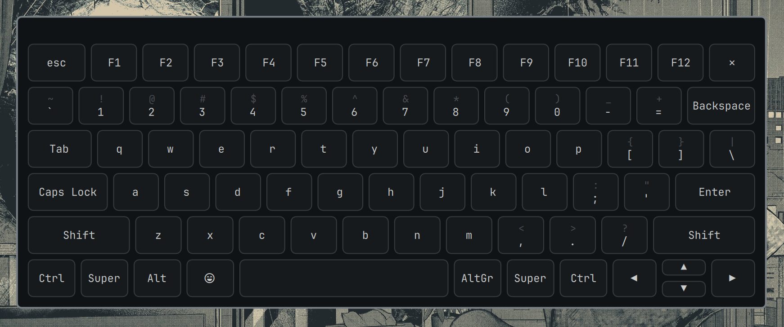

# On-Screen Keyboard



A clickable QWERTY keyboard panel for the Omarchy Quattro bar. Types
directly into whatever window currently has focus, using `wtype`. Omarchy
ships with `wtype` preinstalled; if it is missing, the keyboard shows an
Install button for the required dependencies.

Declared as a standalone `panel` + `bar-widget` plugin (not a nested
bar-popover) so it's fully independent of the bar's normal
click-away-closes-popouts behavior — it only opens or closes when you
click the bar icon or the panel's own close button.

## Requirements

- `wtype` is preinstalled on Omarchy. If it is missing, use the keyboard's
  Install button, or run `omarchy pkg add wtype hyprland`.
- Hyprland + `hyprctl` — used to read and cycle the keyboard layout.
- `xkbcli` (ships with `libxkbcommon`, already a Hyprland dependency) — used to
  compile the active layout so the key caps show the right symbols.

## Key labels and scripts

Key caps come from the layout's compiled xkb symbols. Keysym names (`Arabic_beh`,
`Cyrillic_zhe`, `hebrew_qoph`, ...) are resolved through `Keysyms.js`, which is
generated from the full xkbcommon keysym table, so every script xkb supports is
labelled and typed. Scripts with case (Latin, Cyrillic, Greek, Armenian, ...) get
Caps Lock/Shift case swapping, including Turkish/Azeri dotted and dotless i;
caseless scripts (Arabic, Hebrew, Thai, Georgian, Devanagari, ...) render as
single keys that Caps Lock leaves alone.

To regenerate `Keysyms.js` (e.g. after a libxkbcommon update):

```sh
python3 tools/gen-keysyms.py [/usr/include/xkbcommon/xkbcommon-keysyms.h]
```

Tests (need `node` and `xkbcli`): `node tests/run.js`

## Install

```sh
omarchy plugin add https://github.com/abdxdev/omarchy-onscreen-keyboard.git --enable
```

## Usage

Click the keyboard icon in the bar to open or close the keyboard.
You can also drag the keyboard around your screen by clicking and holding the top bar.

- **Language Switching:** The top bar features a language switcher button that detects your physical keyboard's active layout (e.g. `English (US)`, `Urdu (Pakistan)`). Clicking it will cycle through your system's available layouts and instantly sync both your on-screen and physical keyboard (`hyprctl switchxkblayout`).
- **Shift** applies to the next key only, then resets.
- **Caps** toggles and stays on until pressed again.
- **Ctrl / Alt / Super / AltGr** arm a one-shot modifier combo for the next key press. **Double-press** these modifiers to lock them.
- **Delete / Backspace:** Includes both a standard Backspace and a dedicated Delete key.
- Close the keyboard by clicking the ✕ in the top right, or clicking the bar icon again.

## Configure

```sh
omarchy bar move io.github.abdxdev.onscreen-keyboard --section right
```

## Remove

```sh
omarchy plugin remove io.github.abdxdev.onscreen-keyboard
```
